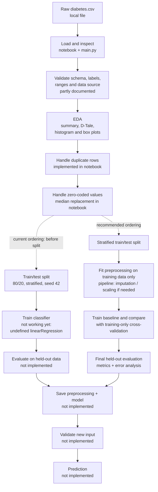

# Diabetes Prediction Model

## Project overview

This is a beginner's binary-classification project built around a local
`diabetes.csv` file. The intended objective is to use eight numeric health and
demographic measurements to predict `Outcome`:

- `0`: the record is labeled as not having diabetes
- `1`: the record is labeled as having diabetes

This repository is a learning project, not a medical product. Its current
notebook starts data exploration and preprocessing, but it does **not yet
complete a working classifier**. In particular, the final training cell calls
an undefined name, and there is no model evaluation or prediction workflow.
The sections below describe the code as it exists and identify the next steps
needed to finish it.

## Project files

| File | What it currently does |
|---|---|
| `diabetes.csv` | Local dataset used by the notebook and `main.py`. |
| `DiabetesPredictionModel.ipynb` | Main exploration/preprocessing notebook; ends with a train/test split and an incomplete model-training cell. |
| `main.py` | Loads and prints the CSV, then opens it in D-Tale for interactive exploration. It is not a prediction application. |

There is currently no dependency manifest, saved model, test suite, or
prediction/API script in the project.

## Dataset

The CSV currently has **769 rows and 9 columns**, including the target.
Its column names are consistent with a commonly used Pima-style diabetes
dataset, but this repository does not document the dataset's source, license,
collection process, or intended population. Record and verify those details
before sharing or using the data beyond this learning exercise.

| Column | Meaning in the dataset |
|---|---|
| `Pregnancies` | Number of pregnancies |
| `Glucose` | Glucose measurement |
| `BloodPressure` | Blood pressure measurement |
| `SkinThickness` | Skin thickness measurement |
| `Insulin` | Insulin measurement |
| `BMI` | Body mass index |
| `DiabetesPedigreeFunction` | Dataset-specific diabetes pedigree score |
| `Age` | Age |
| `Outcome` | Binary target label (`0` or `1`) |

The CSV has no explicit null values, but some measurement columns contain
zeroes that may represent missing or invalid measurements. Before duplicate
removal, the observed class counts are 500 records with `Outcome = 0` and 269
with `Outcome = 1` (about 65% / 35%). The main notebook drops one duplicate,
leaving 768 rows. These class counts describe this file, not the prevalence of
diabetes in a population.

## Current workflow: what is present

### 1. Data loading and initial inspection — present

The main notebook reads `diabetes.csv` with pandas and inspects its shape, columns,
types, sample rows, summary statistics, null counts, and duplicate rows.
`main.py` also loads the file and displays it with D-Tale. Paths are relative,
so run these commands from the project directory.

### 2. Duplicate and zero handling — partly present

The main notebook removes exact duplicate rows. It identifies zero values and
replaces zeroes in `Glucose`, `BloodPressure`, `SkinThickness`, `Insulin`, and
`BMI` with each column's median. This is a preprocessing choice in the notebook,
not a validated clinical rule: a zero can mean different things depending on
the field, and imputation can affect the model.

This median-replacement choice has not been validated using domain guidance or
a comparison on training data. Document the rationale and compare alternatives
as part of model validation.

### 3. Exploratory data analysis — started

The main notebook explores summary statistics and plots an insulin histogram
and box plot. This is useful initial EDA, but there is no recorded set of
findings, systematic feature/target comparison, or documented rationale for
decisions based on the plots.

### 4. Feature preparation and split — partly present

The main notebook sets `X` to all columns except `Outcome`, uses `Outcome` as
`y`, and creates an 80/20 train/test split with a fixed seed and stratification.
All eight predictor columns are numeric, so categorical encoding is not
currently needed. No feature selection or scaling is implemented.

Important issue: zero imputation happens **before** the train/test split, so
the medians are calculated using information from the future test set. For an
honest evaluation, split first and fit imputation (and any scaling or feature
selection) on training data only, preferably in a scikit-learn `Pipeline`.

### 5. Model training — not completed

The notebook imports `LinearRegression`, `LogisticRegression`,
`DecisionTreeClassifier`, and `RandomForestClassifier`, but importing a model
does not train or compare it. The last cell calls `linearRegression()`, which
is undefined (Python is case-sensitive; the imported name is
`LinearRegression`). Even changing the capitalization would not make ordinary
linear regression the appropriate estimator for a binary classification
target. A classifier such as logistic regression is a reasonable beginner
baseline; tree-based classifiers can be compared afterward.

### 6. Evaluation and prediction — not implemented

Metric functions are imported, but no model is fitted successfully, no
predictions are made, and no metrics or confusion matrix are calculated. There
is also no saved model or reusable function/script that accepts a new record.
Consequently, the current project cannot yet report model performance or make
a supported prediction.

## Recommended end-to-end workflow

Use this order when continuing the project:

1. **Document the data** — find the original source, license, population,
   collection context, target definition, and feature units. Check that the
   data may be used for your purpose.
2. **Validate the input** — confirm expected columns and types, target values,
   missing values, exact duplicates, invalid ranges, and suspicious
   measurements. Do not silently interpret every zero as missing.
3. **Explore the training data** — inspect distributions, class balance,
   feature relationships, and potential outliers. Write down what you learn
   and which choices are justified by data knowledge.
4. **Separate features and target** — keep `Outcome` out of the input features.
   Split off a stratified test set before fitting any data-dependent
   preprocessing. Keep the test set untouched until the final evaluation.
5. **Build preprocessing and a baseline together** — use a pipeline to impute
   missing/special values and apply scaling if the chosen model needs it.
   Fit every preprocessing step on training data only. Train a simple
   classifier first, then compare alternatives using cross-validation on the
   training set.
6. **Evaluate appropriately** — report confusion matrix, precision, recall,
   F1, and ROC-AUC (and optionally PR-AUC), in addition to accuracy. In a
   health-related task, false negatives and false positives have different
   consequences; choose metrics and any decision threshold for a stated
   reason. Do not select a model by test-set results and then report that same
   test result as an unbiased final estimate.
7. **Check reliability and limitations** — investigate errors, calibration,
   subgroup performance where appropriate and supported by sufficient data,
   and whether the evaluation population matches intended use. A small or
   unrepresentative dataset cannot establish clinical safety or real-world
   generalization.
8. **Finalize and reuse** — after model selection, evaluate once on the held-out
   test set, save the complete preprocessing-plus-model pipeline, and write a
   prediction interface that validates input names, units, ranges, and missing
   values. Add tests for the pipeline and prediction interface.
9. **Make the work reproducible** — record package versions, random seeds,
   data provenance, preprocessing choices, model settings, and evaluation
   results. Add a dependency file and instructions to reproduce the run.

### Pipeline flowchart

Solid stages are represented in the current files; dashed stages are important
work that remains to be implemented. The diagram shows the intended complete
flow and highlights that the current notebook preprocesses before splitting.



## Running the project locally

The project has no `requirements.txt` or `pyproject.toml` yet. From
PowerShell, in the project directory, create and activate a virtual environment
and install the packages used by the current files:

```powershell
py -m venv .venv
.\.venv\Scripts\Activate.ps1
python -m pip install pandas numpy matplotlib seaborn scikit-learn dtale jupyter
```

If PowerShell blocks activation, use the Python executable directly instead:

```powershell
.\.venv\Scripts\python.exe -m pip install pandas numpy matplotlib seaborn scikit-learn dtale jupyter
```

Open the main notebook from the project directory:

```powershell
.\.venv\Scripts\python.exe -m jupyter notebook DiabetesPredictionModel.ipynb
```

Run the exploratory script from the same directory:

```powershell
.\.venv\Scripts\python.exe main.py
```

`main.py` opens D-Tale for exploration; it does not train a model. The notebook
currently stops at an incomplete training cell, so do not expect an evaluated
model or a prediction from these commands.

## Safe interpretation

This project is for learning the machine-learning workflow. Its dataset,
preprocessing, and evaluation have not been validated for diagnosis, screening,
treatment, or other clinical decisions. A model's output must not be presented
as a medical diagnosis or substituted for advice from a qualified healthcare
professional.
